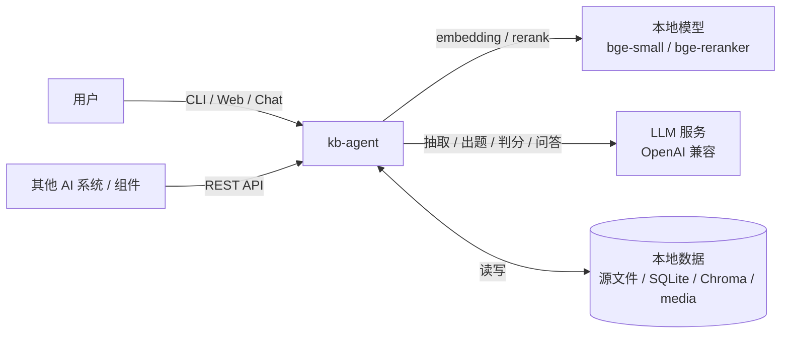
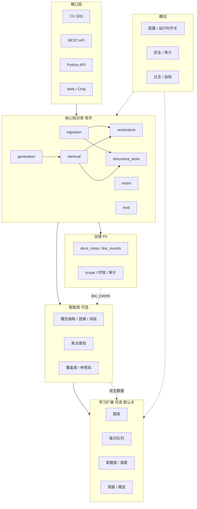
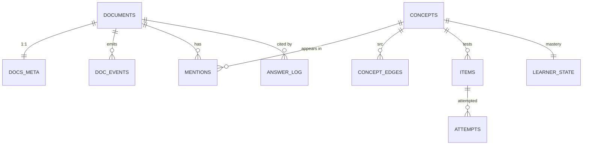
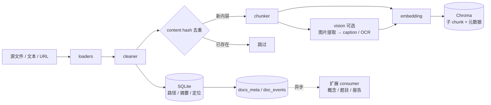
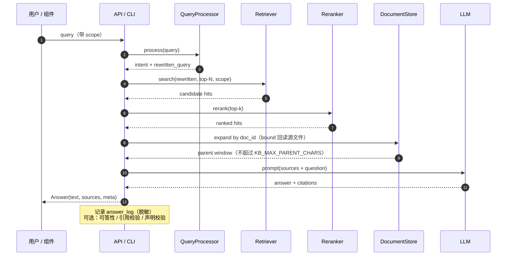
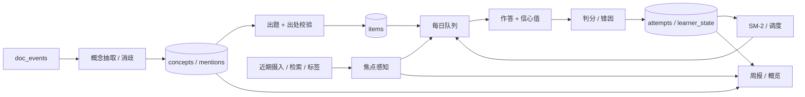
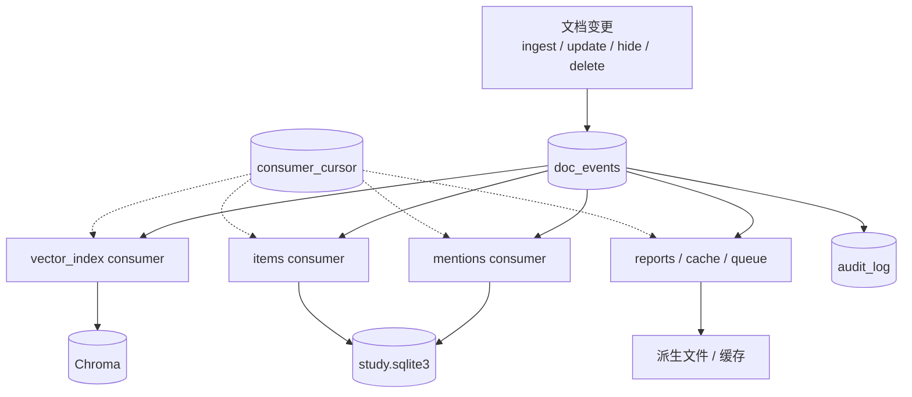
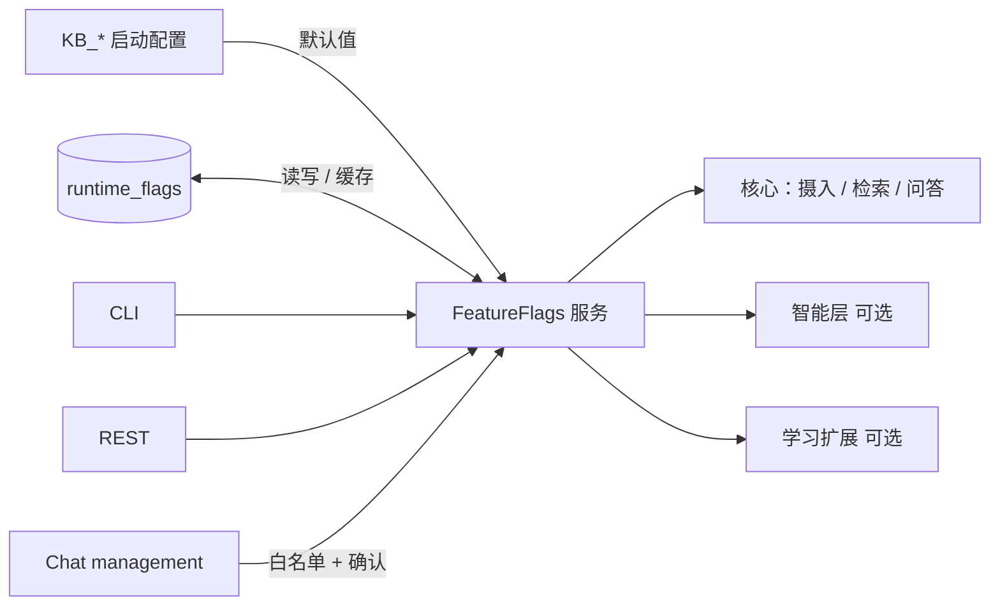
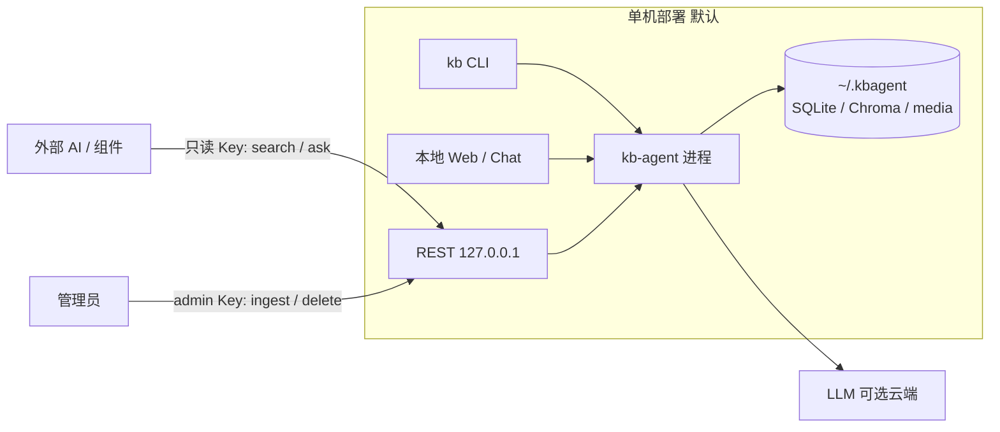

# kb-agent 架构设计

> 状态：与 [PLAN v4](../PLAN.md) 对齐。L1 已实现。2026-11-03 起，MVP 主路径是解耦的学习模块；原件不双写见 [ADR 0002](./adr/0002-no-original-duplication.md)。
> 定位：本地学习助手，同时是可被 Grok、DeepSeek Harness 调用的知识库组件。不执行 shell、HTTP、文件系统、浏览器或任意代码。打开原文是本机固定动作。
> 配套：[愿景](./vision.md) · [L1→L3 拆解](./mvp-l1-to-l3.md) · [知识治理](./knowledge-governance.md) · [ADR 0001 存储选型](./adr/0001-storage.md) · [ADR 0002 原件不双写](./adr/0002-no-original-duplication.md)

---

## 1. 设计原则

1. **源文件是唯一事实来源**：Markdown / PDF / 网页。索引与学习数据是派生物。绑定来源的整篇正文不写入应用库，见 ADR 0002
2. **核心轻量**：摄入、整理、检索、问答始终可用，不依赖学习模块
3. **学习模块解耦**：题库、队列、掌握度是独立模块。托盘默认开启；库与组件集成默认关闭。失败不阻塞核心
4. **单向依赖**：核心不依赖 `study`，以后也不依赖工作模块；`study` 依赖核心
5. **本机优先 + 组件化**：托盘 / 小窗与 CLI 留给人；REST / MCP / Python API 给 Grok、DeepSeek Harness 等调用方。同步通道按多设备预留，MVP 不做移动端
6. **受控能力面**：管理操作限于白名单命令；不提供通用工具调用。打开原文是本机固定动作

---

## 2. 系统上下文

**边界**：

- 只有 LLM / 本地模型两类外部调用；没有 shell、HTTP 抓取、浏览器、代码执行工具
- 默认只监听 `127.0.0.1`；对外集成通过 REST，只读 Key 与 admin Key 分权

---

## 3. 分层架构

**核心 vs 扩展**：

| 层 | 内容 | 默认 | 失败影响 |
| --- | --- | --- | --- |
| 核心知识库 | 摄入 / 检索 / 问答 / 管理 / 评估 | 常开 | 主流程 |
| 治理 | scope / 时效 / 事件 / 审计 | 常开（P0） | 数据一致性 |
| 智能层 | 概念、焦点、覆盖度 | 可关 | 不影响检索 |
| 学习扩展 | 题库、队列、掌握度、周报 | 默认关 | 不影响核心 |

---

## 4. 功能模块

| 模块 | 职责 | 状态 |
| --- | --- | --- |
| `ingestion/` | loaders → cleaner → chunker → indexer；哈希去重、更新/删除 | ✅ v0.1.0 |
| `embedding/` | 本地 CPU 嵌入（bge-small-zh） | ✅ |
| `vectorstore/` | `VectorStore` Protocol + Chroma 适配器 | ✅ |
| `document_store/` | `DocumentStore` Protocol + SQLite 父文档库 | ✅ |
| `storage/` | 后端中立 Filter、工厂、契约测试 | ✅ |
| `retrieval/` | 意图/改写 → 检索 → 重排 → 父文档扩写 | ✅ |
| `generation/` | LLM 客户端 + RAG 管线（编号引用、多模态） | ✅ |
| `vision/` | 图片提取 → caption → OCR → 图文单元 | ✅ |
| `eval/` | 评测集、指标、LLM-as-judge、对比报告 | ✅ |
| `api/` / `ui/` / `cli.py` | REST / Gradio / CLI | ✅ |
| `kb.py` | `KnowledgeBase` 门面（线程安全） | ✅ |
| 治理 + 观测 | `docs_meta`、`doc_events`、`consumer_cursor`、scope、hide/unhide、`answer_log`、`audit_log`、`embedding_manifest` | ✅ 2026-10-30 |
| `FeatureFlags` | `runtime_flags` + 热切换 | ✅ 2026-10-30 |
| `study/` | 硬编码 3 题、作答、SM-2 下次到期。概念 / 正式出题 / 周报未做 | ✅ 学习切片 |

---

## 5. 数据架构

| 存储 | 内容 | 可重建 |
| --- | --- | --- |
| 源文件 | Markdown / PDF / 网页 | ✅ 唯一事实来源 |
| `documents.sqlite3` | 路径、哈希、摘要、切块定位、`docs_meta`、`doc_relations`、`doc_events`、`consumer_cursor`、`answer_log`、`audit_log`、`embedding_manifest`、`runtime_pointer`、`runtime_flags`。绑定原件不存整篇正文。无外部原件的 `inline` 正文留在库内；源文件已丢失的旧副本标为 `orphaned_copy` | 索引可从源文件重建 |
| `study.sqlite3` | 学习切片：`items`、`attempts`、`reviews`、`schema_version`。概念、mentions、learner_state、周报还没有建表 | 作答和当前到期不能从文档重建 |
| Chroma | 子 chunk 向量 + 元数据（`doc_id`、`scope`、`status`、`valid_until`、`manifest_id`） | ✅ |
| `media/` | 图片等媒体文件 | ✅（从源文件重建） |
| 派生文件 | 概念页、周报、参照系 | ✅ |

**不可重建的数据**：`attempts`、`learner_state`（以及未来的复习历史）必须独立备份；其余派生数据可通过事件重放重建。

---

## 6. 写入流程（摄入）

**目标一致性模型**：父文档与 `doc_events` 在同一事务落库；向量索引、概念、题目、报告由 consumer 异步派生。当前 L1 仍为同步写入，P0 接入 outbox 后切换。

---

## 7. 读取流程（检索 / 问答）

**关键约束**：

- 绑定原件的父文档扩写回读源文件，不从 SQLite 取整篇正文（ADR 0002）
- 检索必须带 scope 条件，隐藏文档在存储层过滤
- 答案只依据编号来源，每个事实句带引用
- 无相关内容时拒答，不臆造
- `answer_log` 记录检索结果、引用、校验结果，但不落密钥

---

## 8. 学习扩展流程（可选）

**边界**：

- 默认关闭是库与组件集成的启动值；托盘默认开启学习模块。`study.enabled=false` 时学习链路不运行
- 2026-11-12 已落地的只有硬编码切片：`kb study today` / `kb study answer`，数据在 `items` / `attempts` / `reviews`。上图里的概念抽取、正式出题、learner_state 和周报还没有。队列的今天是 Asia/Shanghai；P2 过期仍用 UTC。到期日前的作答不推进 SM-2
- 开启不自动回填历史；关闭不删数据
- 焦点感知只影响排序，不限制检索，也不是目标管理
- 题目必须带出处；质量不达标进入隔离区

---

## 9. 治理与事件流

**级联规则**：

- 隐藏 / 删除 / 更新通过事件传播，不靠各处手写清理
- consumer 幂等，可从 cursor 重放
- 学习历史不可重建，单独备份
- 隐藏内容在检索、父文档、概念、题目、报告、缓存、日志七层生效

---

## 10. 运行时开关

- `Settings` 只做启动默认值；运行时以 `runtime_flags` 为准
- 热切换无需重启；关闭不删除数据
- 聊天只能操作白名单 flag，写操作二次确认
- 安全 / 隐私 / 密钥类配置不允许从聊天修改

---

## 11. 部署形态

- 本机托盘 / 小窗是产品主界面，原文用 Obsidian 或系统默认应用打开
- CLI、REST、MCP 保留。默认监听 `127.0.0.1`
- 作为组件时，只读与管理 Key 分离；`where` / `collection` 白名单
- 同步通道按多设备预留：默关的加密远程同步，以及同 Wi-Fi 配对同步。MVP 不做移动端
- 不提供通用工具调用，不需要沙箱。打开原文是固定的本机动作

---

## 12. 安全边界

| 风险 | 对策 |
| --- | --- |
| 隐藏数据被检索/返回 | scope 在检索链路过滤（P0 为 doc-level 后过滤 + chunk 元数据；存储层强制过滤后续强化）；输出裁剪 |
| 密钥泄漏 | 密钥只在环境变量/keyring；不入 prompt、日志、回答；常量时间比较 |
| 外部组件滥用 | 只读/admin Key 分权、限流、请求大小、超时、审计 |
| 上传滥用 | 大小/类型限制、临时文件清理、解析保护 |
| Prompt injection | 参考资料按“数据”分隔；文档内容不得触发管理命令 |
| 管理命令误执行 | 白名单、二次确认、dry-run、审计、软删除 |
| 非本地暴露 | 默认绑 `127.0.0.1`；非 loopback 无 Key 拒绝启动 |

---

## 13. 评估与可观测

| 层 | 指标 | 入口 |
| --- | --- | --- |
| 检索 | Recall@k、Precision@k、MRR、NDCG、p95 延迟 | `kb eval --mode retrieval` |
| 生成 | Accuracy、Faithfulness、引用准确率、拒答/误拒 | `kb eval --mode full` |
| 学习（扩展） | 保持率、校准、队列完成率、题目有效率 | 试点 / 周报 |
| 治理 | 隐藏泄漏、过期率、重复率、top-k 重复占比 | 回归测试 / 周报 |
| 运行 | `answer_log`、`audit_log`、工具/开关变更 | 本地日志 / API |

---

## 14. 当前实现状态

| 能力 | 状态 |
| --- | --- |
| L1 摄入 / 检索 / 问答 / 多模态 / 评估 / CLI / REST / UI | ✅ v0.1.0 |
| 存储抽象（Protocol / Filter / 工厂 / 契约测试） | ✅ 2026-10-29 |
| `docs_meta` / `doc_events` / `consumer_cursor` / scope / hide-unhide | ✅ 2026-10-30 |
| `runtime_flags` / `FeatureFlags` 热切换 | ✅ 2026-10-30 |
| `answer_log` / `audit_log` | ✅ 2026-10-30 |
| `embedding_manifest` / `runtime_pointer` | ✅ 2026-10-30 |
| 只读 / admin Key 分权 | ✅ 2026-10-30 |
| 过期与冲突检测 / 严格模式 / 去重 | 🟡 P2 |
| 概念 / 焦点 / 覆盖度 | ⬜ L2 |
| 题库 / 队列 / 掌握度 / 周报 | ⬜ L3 |

---

## 15. 关键架构决策

- 存储：Chroma + SQLite，通过 Protocol 抽象，迁移阈值见 [ADR 0001](./adr/0001-storage.md)
- 源文件优先：所有索引与学习数据可重建
- 扩展模块可关、可热切换、单向依赖。托盘默认进入学习闭环
- 原件不双写，见 ADR 0002
- 不引入通用工具调用；管理操作白名单化
- 本机优先。REST / MCP / Python API 是知识库组件的调用面，供 Grok、DeepSeek Harness 等使用
